<div align="center">

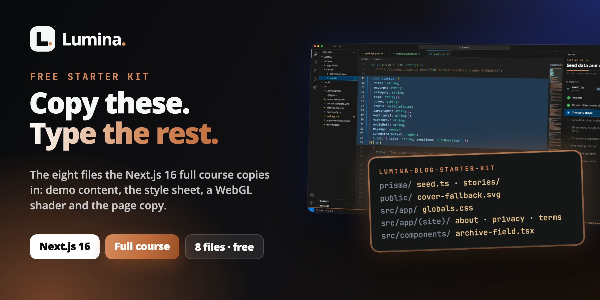

# Lumina Blog Starter Kit

**The free starter kit for the _Lumina from Scratch_ course: build a complete Next.js 16 publishing platform, from an empty folder to a live site.**

[](https://www.youtube.com/@reactjsbd)
[](https://buymeacoffee.com/reactbd/e/597995)
[](https://lumina.noksha.dev)


</div>

---

In the course you type every line of the app yourself, file by file, in VS Code. A few files are content, not logic:
the demo stories, a 676-line style sheet, a WebGL shader and the legal page copy. Typing those would teach you
nothing, so they live here. When the video reaches one, you copy it in and we read it together.

> [!NOTE]
> **This repository is the starter kit only.** It holds the 8 files the course copies in, nothing else. It is not an
> app you can run on its own. You build the app by following the course. In the video, this kit is called **the free
> asset pack**.

## What's inside

| File | What it is | Copy it in at | Lines |
| --- | --- | --- | ---: |
| [`src/app/globals.css`](src/app/globals.css) | The design system: colour tokens for light and dark, fonts, radii, motion and the article styles | Part 2 · The design system | 676 |
| [`prisma/stories/boring-pipelines.ts`](prisma/stories/boring-pipelines.ts) | The long demo story, its key points and its comment thread | Part 5 · Seed data and every role | 112 |
| [`prisma/seed.ts`](prisma/seed.ts) | The demo content: 8 accounts across every role, 14 stories, quizzes, comments, follows and more | Part 5 · Seed data and every role | 573 |
| [`src/components/archive-field.tsx`](src/components/archive-field.tsx) | The WebGL background behind the Ask Lumina band | Part 9 · The home page | 264 |
| [`public/cover-fallback.svg`](public/cover-fallback.svg) | The placeholder cover for a story without one | Part 15 · The writer desk | 6 |
| [`src/app/(site)/about/page.tsx`](<src/app/(site)/about/page.tsx>) | The about page | Part 19 · Email, the newsletter and static pages | 49 |
| [`src/app/(site)/privacy/page.tsx`](<src/app/(site)/privacy/page.tsx>) | The privacy page copy (a placeholder: write your own before launch) | Part 19 · Email, the newsletter and static pages | 84 |
| [`src/app/(site)/terms/page.tsx`](<src/app/(site)/terms/page.tsx>) | The terms page copy (a placeholder: write your own before launch) | Part 19 · Email, the newsletter and static pages | 64 |

Every file sits at the same path it has in your project, so there is never a question of where it goes.

## How to use it

1. **Get the files.** Click **Code → Download ZIP** above, download `lumina-starter-kit.zip` from
   [Releases](https://github.com/noorjsdivs/lumina-blog-starter-kit/releases/latest), or clone the repository:

   ```bash
   git clone https://github.com/noorjsdivs/lumina-blog-starter-kit.git
   ```

2. **Start the course from Part 1,** in an empty folder of your own. Keep this kit beside it.
3. **Copy a file when the video asks for it.** The lesson panel shows **FROM THE ASSET PACK** on that file. Copy just
   that one file to the same path in your project. If the file already exists, as `globals.css` does after
   `shadcn init`, replace it.
4. **Copy each file at its own part, not all at once.** Each one leans on code you write in that part or earlier.
   For example, `seed.ts` needs `bcryptjs` from Part 5, and the privacy and terms pages need the legal page component
   you write in Part 19. Copied in early, they break the type check.

<p align="center">
  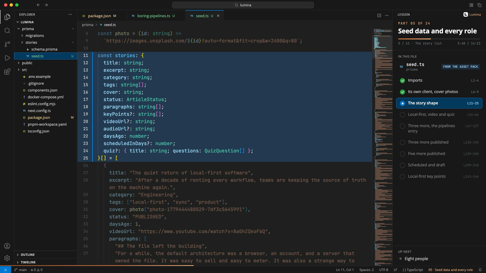
  <br />
  <sub>Part 5: <code>seed.ts</code> comes from the kit, and the lesson panel walks through it section by section.</sub>
</p>

## Before you start

| You need | Notes |
| --- | --- |
| **Node.js 22** or newer | Check with `node -v`. Install the LTS from [nodejs.org](https://nodejs.org) if it's older. |
| **pnpm** | If `pnpm -v` isn't found, run `corepack enable` once. Corepack ships with Node. |
| **VS Code** or any editor | The course is recorded in VS Code. |
| **Chrome** | For the checkpoints and the phone view. |
| **Docker**, or a free **[Neon](https://neon.tech)** database | Postgres for Part 3 onwards. |

Every other service (Google and GitHub sign-in, Cloudinary, Vercel Blob, Resend, Anthropic, Turnstile) has a free
plan, and the app runs without any of them. Part 23 sets up each key, one by one.

<details>
<summary><b>Every install, part by part (pinned versions)</b></summary>

<br />

Every package is pinned to the exact version used in the course, so your project matches the video line for line.

```bash
# Part 1 · An empty folder
node -v && pnpm -v
pnpm create next-app@16.4.6 lumina --ts --tailwind --eslint --app --src-dir --react-compiler --import-alias "@/*" --use-pnpm --no-agents-md --no-agent-feedback
cd lumina
pnpm dev

# Part 2 · The design system
pnpm dlx shadcn@4.23.0 init
pnpm dlx shadcn@4.23.0 add alert-dialog avatar badge button card checkbox dialog dropdown-menu form input label scroll-area select separator sheet skeleton sonner table tabs textarea tooltip
pnpm add next-themes@0.4.6 @tailwindcss/typography@0.5.20 @tanstack/react-query@5.107.1 cn@0.5.2 class-variance-authority@0.7.1 radix-ui@1.8.1 lucide-react@1.71.0 sonner@2.0.8 tw-animate-css@1.4.0 shadcn@4.23.0 react-hook-form@7.91.0

# Part 3 · The database
docker compose up -d
pnpm add @prisma/client@6.19.3 server-only@0.0.1
pnpm add -D prisma@6.19.3
pnpm exec prisma migrate dev --name init

# Part 5 · Seed data and every role
pnpm add bcryptjs@3.0.3
pnpm add -D tsx@4.23.15 @types/bcryptjs@2.4.6
pnpm db:seed
pnpm exec prisma studio

# Part 6 · Reading data with the cache
pnpm add zod@4.6.7

# Part 7 · Accounts and roles
pnpm add next-auth@5.0.0-beta.32 @hookform/resolvers@7.0.5

# Part 9 · The home page
pnpm add three@0.187.0 date-fns@4.4.0
pnpm add -D @types/three@0.187.0

# Part 10 · The story page
pnpm add @tiptap/core@3.33.1 @tiptap/pm@3.33.1 @tiptap/html@3.33.1 @tiptap/starter-kit@3.33.1 @tiptap/extension-image@3.33.1 @tiptap/extension-link@3.33.1 @tiptap/extension-table@3.33.1 @tiptap/extension-youtube@3.33.1

# Part 16 · Uploads and media libraries
pnpm add @vercel/blob@2.9.0

# Part 17 · The story editor
pnpm add @tiptap/react@3.33.1

# Part 22 · Testing it
pnpm add -D @playwright/test@1.65.0
pnpm check
pnpm test:e2e

# Part 23 · Every key, and where to get it
pnpm run setup

# Part 24 · Going live
pnpm exec prisma migrate deploy && pnpm build
```

The scripts these commands call (`db:seed`, `check`, `test:e2e`, `setup`) are added in the video, in the part that
first runs them.

</details>

## Demo accounts

After Part 5, `pnpm db:seed` fills the database with a whole publication and one account for every role. Every
account's password is **`lumina123`**.

| Email | Role | Use it to see |
| --- | --- | --- |
| `admin@lumina.dev` | Admin | The admin desk: analytics, roles, bans, moderation |
| `writer@lumina.dev` | Writer | The writer desk: drafts, scheduled and published stories |
| `mira@lumina.dev` · `theo@lumina.dev` | Writer | Other writers' stories, which a writer can't edit |
| `reader@lumina.dev` | Reader | The reader desk: saves, history, quizzes, follows |
| `priya@lumina.dev` · `leo@lumina.dev` | Reader | More readers, for comments and follows |
| `banned@lumina.dev` | Banned reader | What a banned account sees |

> [!WARNING]
> These accounts are for your own machine. Change their passwords, or remove them, before you put your site online.

## The course, part by part

Each part teaches one idea, in the order you'd build it, and ends with a checkpoint where you run the app.

| | Part | Starts at |
| ---: | --- | --- |
| 1 | An empty folder | 0:07:38 |
| 2 | The design system | 0:18:24 |
| 3 | The database | 0:53:24 |
| 4 | The core logic | 1:11:48 |
| 5 | Seed data and every role | 1:31:43 |
| 6 | Reading data with the cache | 1:45:56 |
| 7 | Accounts and roles | 2:04:56 |
| 8 | The site shell | 2:41:44 |
| 9 | The home page | 3:08:12 |
| 10 | The story page | 3:34:38 |
| 11 | Saving, following, quizzes and comments | 3:57:34 |
| 12 | Browsing: sections, tags and writers | 4:21:51 |
| 13 | Search that forgives typos | 4:34:34 |
| 14 | The reader desk | 4:58:11 |
| 15 | The writer desk | 5:25:45 |
| 16 | Uploads and media libraries | 5:42:30 |
| 17 | The story editor | 6:09:28 |
| 18 | Ask Lumina | 6:33:04 |
| 19 | Email, the newsletter and static pages | 6:59:14 |
| 20 | The admin desk | 7:32:46 |
| 21 | SEO and feeds | 8:02:04 |
| 22 | Testing it | 8:14:49 |
| 23 | Every key, and where to get it | 8:31:14 |
| 24 | Going live | 8:45:45 |

## What you'll build

Lumina is a calm, complete publishing platform in one Next.js 16 app: a reading site, three desks (reader, writer
and admin), and Ask Lumina, a reader assistant that knows every story. Every screen reads and writes real data.

<table>
  <tr>
    <td width="50%">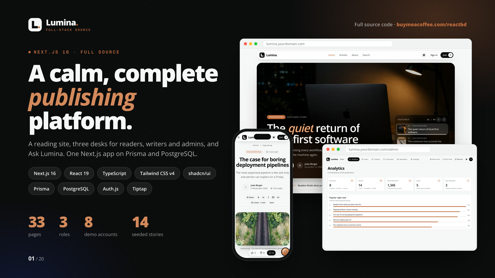</td>
    <td width="50%">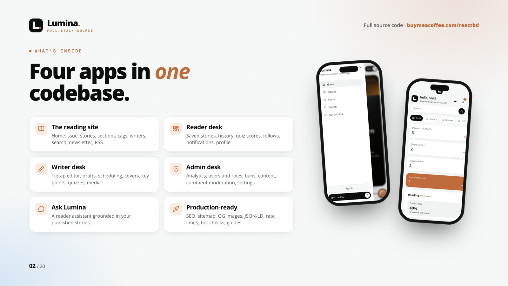</td>
  </tr>
  <tr>
    <td>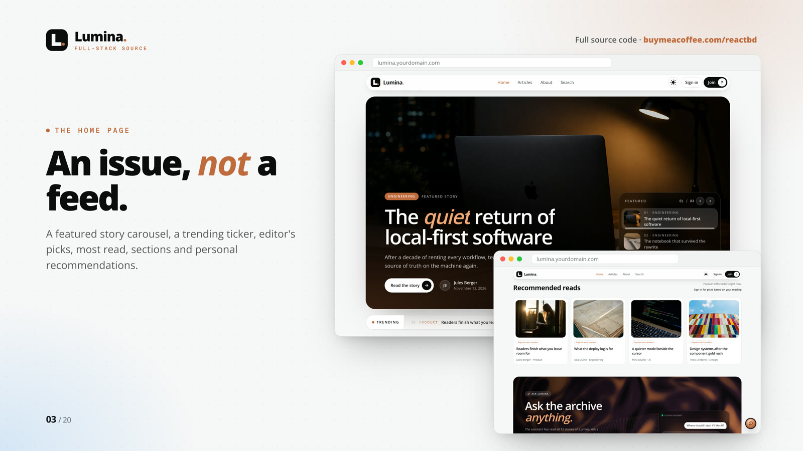</td>
    <td>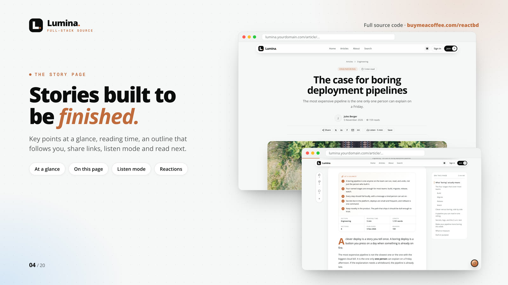</td>
  </tr>
  <tr>
    <td>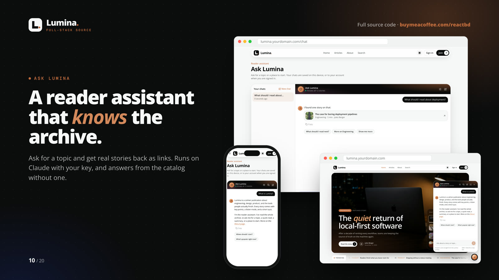</td>
    <td>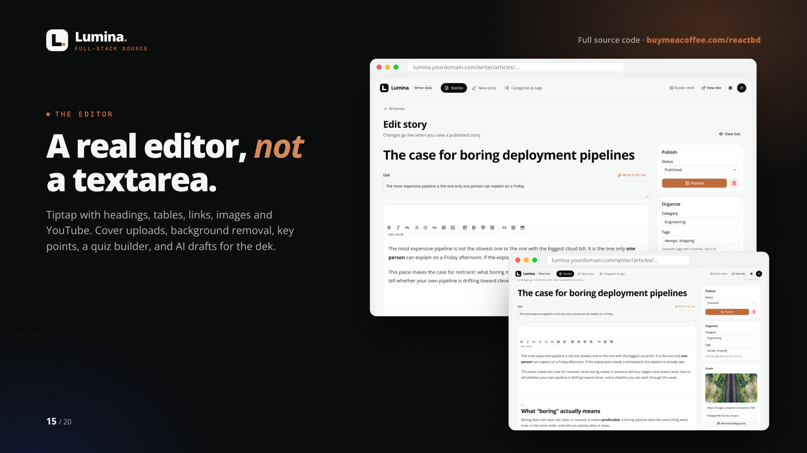</td>
  </tr>
  <tr>
    <td>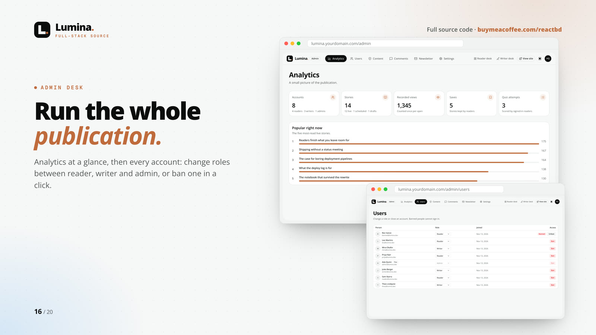</td>
    <td>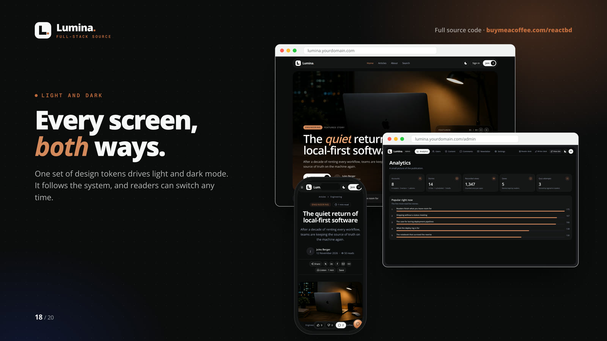</td>
  </tr>
  <tr>
    <td>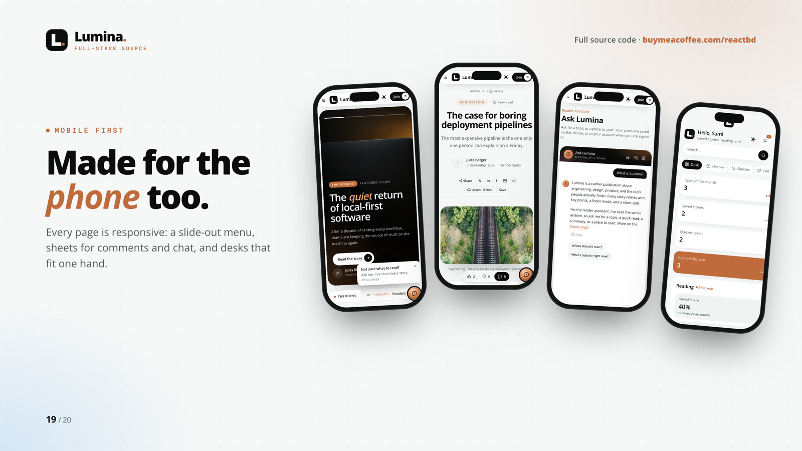</td>
    <td>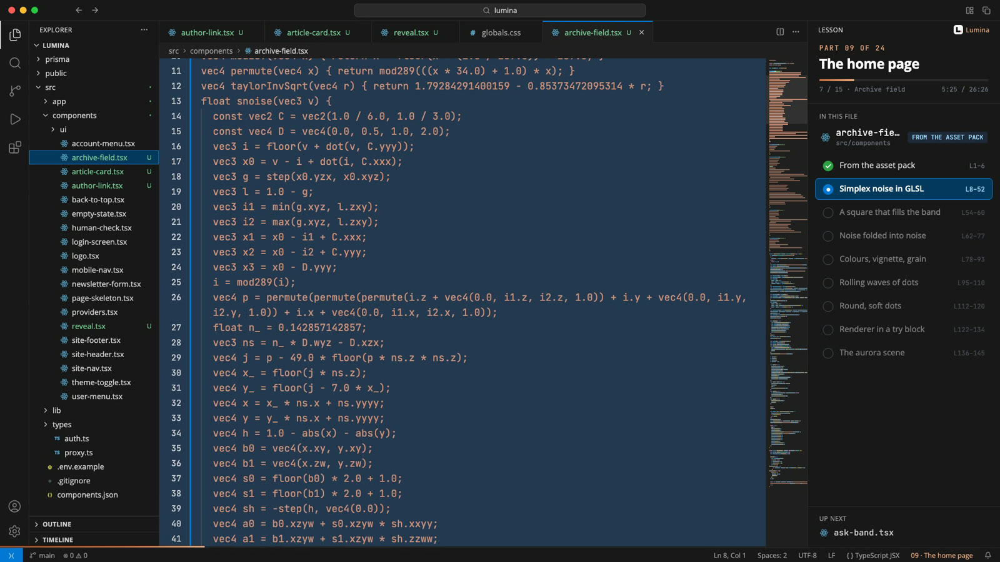</td>
  </tr>
</table>

**Built with:** Next.js 16 (App Router, Cache Components, React Compiler) · React 19 · TypeScript (strict) ·
Tailwind CSS 4 · shadcn/ui · Prisma + PostgreSQL · Auth.js · Tiptap · Zod · Playwright

## Want the finished code?

<a href="https://buymeacoffee.com/reactbd/e/597995">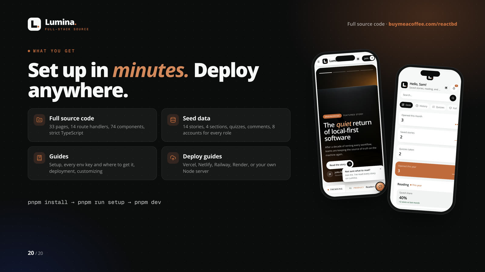</a>

Following the course gets you the whole app, line by line. If you'd rather start from the finished project, or want
it beside you to check your work, the complete source code is on Buy Me a Coffee:

- The full app: 33 pages, 14 route handlers, 74 components, about 17,800 lines of TypeScript
- One-command setup (`pnpm run setup`), and an `.env.example` with every key explained
- Guides: start here, full setup with troubleshooting, every environment setting and where to get each key,
  deployment (Vercel, Netlify, Railway, Render, or your own server), customizing, and the architecture

<p align="center">
  <a href="https://buymeacoffee.com/reactbd/e/597995"></a>
</p>

## Links

| | |
| --- | --- |
| ▶️ The course | [YouTube · ReactBD](https://www.youtube.com/@reactjsbd) |
| 💛 Full source code | [buymeacoffee.com/reactbd/e/597995](https://buymeacoffee.com/reactbd/e/597995) |
| 🌐 Live demo | [lumina.noksha.dev](https://lumina.noksha.dev) |
| ✍️ Articles | [medium.com/@reactbd](https://medium.com/@reactbd) |
| 🏠 Website | [reactbd.com](https://reactbd.com) |

Questions about the course? Ask in the comments under the video. Found a problem with a file here?
[Open an issue](https://github.com/noorjsdivs/lumina-blog-starter-kit/issues).

## License

The files in this starter kit are free to use while you follow the course, and in the app you build with it. See
[LICENSE.md](LICENSE.md). The complete Lumina source code is sold separately under its own licence.
